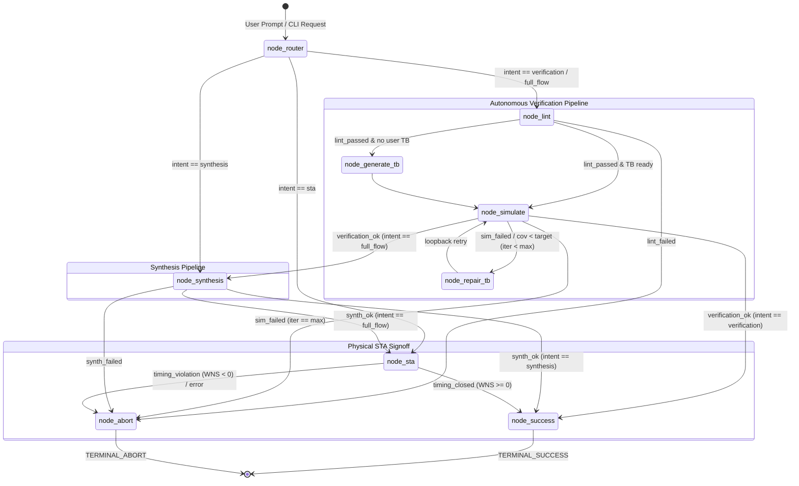

# OpenSourceEDA Copilot

[](https://www.python.org/)
[](https://github.com/langchain-ai/langgraph)
[](https://microsoft.github.io/autogen/)
[](https://github.com/VishKamath/OpenSourceEDA_Copilot)
[](https://github.com/google/skywater-pdk)
[](tests/)
[](LICENSE)

An **Autonomous Multi-Agent AI Copilot** for digital ASIC and FPGA design, verification, logic synthesis, and static timing signoff. 

The copilot maps **Agentic AI** orchestration constructs directly to **ASIC/FPGA and UVM hardware mental models**: utilizing a synchronous **LangGraph Finite State Machine (FSM)** controller, **Microsoft AutoGen** sequencers, memory-isolated **MPU sandboxing**, and automated **reflection/self-healing loops** to autonomously compile, verify, synthesize, and timing-close silicon designs.

---

## 1. System Architecture & Hardware Mental Models

```
+-----------------------------------------------------------------------------------+
|                           LANGGRAPH FSM CONTROLLER                                |
|  - State Vector: Synchronous Register Bank (RTL paths, Tool status, Metrics)     |
|  - Conditional Routing: Combinational Next-State Logic (`case (current_state)`)   |
+-----------------------------------------------------------------------------------+
                                  │           ▲
                Sequencer Packets │           │ Status & Metrics
                                  ▼           │
+-----------------------------------------------------------------------------------+
|                        AUTOGEN AGENTIC SANDBOX HARNESS                            |
|  - Testbench Driver / UVM Sequencer                                               |
|  - Prompt-driven reasoning for test generation & RTL patching                     |
+-----------------------------------------------------------------------------------+
                                  │           ▲
                 Atomic Tool Exec │           │ ToolResult Transaction Packets
                                  ▼           │
+-----------------------------------------------------------------------------------+
|                    LAYER 0 DETERMINISTIC RUNNERS (`tools/`)                       |
|  - Physical Pin BFM / `$system()` wrappers with Watchdog Timers                  |
|  - Sandboxing MPU (Path isolation & containment checks)                           |
+-----------------------------------------------------------------------------------+
        │                      │                     │                    │
        ▼                      ▼                     ▼                    ▼
   [ Icarus / VVP ]       [ Verilator ]          [ Yosys ]            [ OpenSTA ]
    Sim & Functional      Code & Toggle       Logic Synthesis       Static Timing
        Checks               Coverage            Gate Netlist       Slack Closure
```

### Digital Hardware Mapping Dictionary

| Framework Component | Hardware / UVM Equivalent | Role in Copilot |
| :--- | :--- | :--- |
| **LangGraph `TypedDict` State** | **Synchronous Register Bank (`reg [N-1:0]`)** | Holds execution context across cycles: RTL sources, cell counts, coverage %, slacks, and watchdog counts. |
| **LangGraph Edge Conditionals** | **Combinational Next-State Logic (`case`)** | Evaluates slack $WNS \ge 0$ or coverage $\ge 90\%$ to branch between `NEXT_PHASE`, `REPAIR_LOOP`, or `ABORT`. |
| **AutoGen Runner Agent** | **UVM Sequencer / BFM Driver** | Translates natural language instructions into tool transactions. |
| **`ToolResult` Dataclass** | **`uvm_sequence_item` / Transaction Packet** | Immutable telemetry packet carrying exit codes, stdout, stderr, execution time, and extracted metrics. |
| **Path Sandboxing (`pathlib`)** | **Memory Protection Unit (MPU)** | Confines EDA tool generation to isolated volatile workspaces (`workspaces/<tag>_<uuid>/`), preventing root pollution. |
| **Execution Watchdog Timers** | **Hardware Watchdog Timer** | Enforces hard simulation timeouts (`SIGKILL`) to prevent infinite simulation loops or hung tool processes. |

---

## 2. Core Capabilities

### 🤖 1. Natural Language Prompt Specificity & Interactive REPL
* Parse conversational engineer prompts into formal digital constraints:
  * **Target Frequency**: *"target 250MHz"* $\rightarrow$ `clock_period_ns: 4.0`
  * **Jitter Margin**: *"150ps uncertainty"* $\rightarrow$ `uncertainty_ns: 0.15`
  * **Directed Tests**: *"test corner cases and overflow"* $\rightarrow$ Generates all-zeros, max-boundary, and alternating bit patterns.
  * **Stimulus Length**: *"50 cycles of stimulus"* $\rightarrow$ Sets ATPG transaction count.
  * **Synthesis Optimization**: *"optimize for area, flatten hierarchy"* $\rightarrow$ Drives Yosys optimization flags.
* Interactive shell (`main.py --interactive`) for hands-on prompt experimentation.

### 🧪 2. Autonomous Testbench Synthesis (ATPG)
* Parses both **modern ANSI** (SystemVerilog/Verilog-2001) and **legacy non-ANSI** (Verilog-1995) port declarations directly from RTL.
* Generates self-checking Verilog testbenches with clock generators, structured reset sequences, bounded randomized stimulus, directed corner-case vectors, waveform dumping (`.vcd`), and assertion scoreboards.

### 🔄 3. Closed-Loop Self-Healing & Reflection Loop
* Inspects simulation/compiler logs when tests fail or assertions trip.
* Diagnoses root causes (`$fatal` triggers, reset duration mismatches, clock enable deadlocks, watchdog timeouts).
* Automatically patches testbench stimulus and timing guardrails across iterative repair loops without human intervention.

### ⚡ 4. Logic Synthesis & Technology Mapping
* Ingests behavioral RTL and executes technology mapping through **Yosys**.
* Maps standard cells and sequential DFFs using built-in Liberty libraries (**SkyWater 130nm** `sky130hd` and **Nangate 45nm**).
* Extracts gate cell counts, sequential register counts, and estimated silicon chip area.

### ⏱️ 5. Automated SDC Generation & STA Signoff
* Automatically generates standard Synopsys Design Constraints (**SDC**) with clock definitions, uncertainty/jitter margins, and I/O arrival delay budgets.
* Executes **OpenSTA** static timing analysis to calculate Worst Negative Slack (**WNS** setup/hold) and Total Negative Slack (**TNS**), verifying signoff timing closure.

---

## 3. FSM Workflow Diagram



---

## 4. Getting Started

### Prerequisites

Ensure the open-source host EDA toolchain is installed and accessible in your system `PATH`:

```bash
# Ubuntu / Debian
sudo apt-get update
sudo apt-get install -y iverilog verilator yosys

# OpenSTA (build from source or install binary)
# Confirm OpenSTA is in PATH or export STA_BIN=/path/to/sta
sta -version
```

### Installation

Clone the repository and set up the Python virtual environment:

```bash
git clone https://github.com/VishKamath/OpenSourceEDA_Copilot.git
cd OpenSourceEDA_Copilot

# Create and activate virtual environment
python3 -m venv .venv
source .venv/bin/activate

# Install dependencies
pip install -r requirements.txt
```

### Diagnostics Check

Run the built-in diagnostic tool to verify host binaries, Python agentic frameworks, and standard cell Liberty libraries:

```bash
python check_env.py
```

Expected output:
```
======================================================
    AGENTIC EDA COPILOT - MILESTONE 0 DIAGNOSTICS    
======================================================

1. Host EDA Binaries Check:
------------------------------------------------------------
  [PASS] iverilog     -> /usr/bin/iverilog
  [PASS] vvp          -> /usr/bin/vvp
  [PASS] verilator    -> /usr/bin/verilator
  [PASS] yosys        -> /usr/bin/yosys
  [PASS] sta          -> /home/user/.local/bin/sta
------------------------------------------------------------

2. Python Agentic Frameworks Check:
------------------------------------------------------------
  [PASS] langgraph            -> vinstalled
  [PASS] autogen_agentchat    -> v0.7.5
  [PASS] pydantic             -> v2.14.1
------------------------------------------------------------

3. Standard Cell Liberty Library Check:
------------------------------------------------------------
  [PASS] sky130hd_tt.lib.gz   -> /path/to/lib/sky130hd_tt.lib.gz (Local)
------------------------------------------------------------

[DIAGNOSTIC PASSED] All foundational EDA binaries and paths verified.
```

---

## 5. Usage & Examples

### Option A: Natural Language Prompt Specificity (Recommended)

Run autonomous pipelines using conversational prompts specifying your target frequency, corner cases, and stimulus count:

```bash
python main.py \
  --sources ASIC/lab1/4bitRCA/fa.v ASIC/lab1/4bitRCA/bit4_ca.v \
  --prompt "full flow on top module bit4_ca targeting 250MHz with 150ps uncertainty and corner cases"
```

### Option B: Interactive Prompt Shell (REPL)

Launch the conversational shell to prompt the agent interactively:

```bash
python main.py --interactive
```
```
======================================================================
      AUTONOMOUS AGENTIC EDA COPILOT - INTERACTIVE PROMPT SHELL       
======================================================================
Type natural language prompts to drive verification, synthesis, or STA signoff.

copilot> sources ASIC/lab1/4bitRCA/fa.v ASIC/lab1/4bitRCA/bit4_ca.v
copilot> verify bit4_ca with corner cases and 50 cycles of stimulus
copilot> synthesize bit4_ca targeting 500MHz with 150ps uncertainty
copilot> full flow on bit4_ca targeting 200MHz
```

### Option C: Explicit CLI Mode

```bash
# 1. Closed-Loop Verification Only
python main.py --intent verification \
  --top bit4_ca \
  --sources ASIC/lab1/4bitRCA/fa.v ASIC/lab1/4bitRCA/bit4_ca.v

# 2. Logic Synthesis Only
python main.py --intent synthesis \
  --top bit4_ca \
  --sources ASIC/lab1/4bitRCA/fa.v ASIC/lab1/4bitRCA/bit4_ca.v

# 3. Static Timing Analysis (STA) Only
python main.py --intent sta \
  --top gcd \
  --sources lib/gcd_sky130hd.v \
  --sdc lib/gcd_sky130hd.sdc \
  --liberty lib/sky130hd_tt.lib.gz

# 4. Full Flow (Verification -> Synthesis -> STA Signoff)
python main.py --intent full_flow \
  --top bit4_ca \
  --sources ASIC/lab1/4bitRCA/fa.v ASIC/lab1/4bitRCA/bit4_ca.v \
  --clock-period 4.0
```

---

## 6. Project Structure

```
OpenSourceEDA_Copilot/
├── agents/                     # Agentic AI reasoning & tool-binding layers
│   ├── prompt_parser.py        # Natural language prompt interpreter for EDA specificity
│   ├── runner_agent.py         # AutoGen UVM Sequencer persona & sandboxed tool binding
│   ├── verification_agent.py   # Boundary scan AST parser, ATPG generator & self-healing engine
│   └── timing_agent.py         # Automated SDC constraint synthesizer & timing signoff
├── tools/                      # Layer 0 deterministic silicon toolchain
│   ├── eda_runners.py          # Watchdog-guarded, MPU-sandboxed subprocess runners
│   └── tools_runner.py         # Unified tool execution dispatch
├── workflows/                  # LangGraph FSM controller & state register bank
│   ├── graph.py                # StateGraph assembly, conditional routing & dispatch
│   └── state.py                # Synchronous state register bank (`CopilotState`)
├── lib/                        # Standard cell Liberty libraries & benchmarks
│   ├── sky130hd_tt.lib.gz      # SkyWater 130nm HD standard cell library
│   ├── nangate45_typ.lib.gz    # Nangate 45nm typical standard cell library
│   └── gcd_sky130hd.*          # Golden benchmark netlist, SDC, and SPEF files
├── tests/                      # Automated pytest unit & integration test suite
│   ├── test_eda_runners.py     # Deterministic tool wrapper & MPU boundary tests
│   ├── test_fsm_graph.py       # FSM transition & watchdog abort tests
│   ├── test_prompt_parser.py   # Prompt interpretation & constraint decoding tests
│   ├── test_runner_agent.py    # AutoGen FunctionTool execution tests
│   ├── test_synthesis_sta_pipeline.py # Synthesis & STA signoff tests
│   └── test_verification_pipeline.py  # ATPG & closed-loop repair tests
├── check_env.py                # Host toolchain and environment diagnostics
├── eda_copilot_handbook.md     # In-depth architectural & hardware mapping specification
├── main.py                     # Top-level CLI entry point & interactive shell
└── requirements.txt            # Python dependencies
```

---

## 7. Testing & Verification

The framework includes a 25-scenario automated test suite verifying tool execution, FSM routing, prompt parsing, ATPG, and timing closure:

```bash
pytest -v
```

```
============================== test session starts ===============================
collected 25 items

tests/test_eda_runners.py ......                                            [ 24%]
tests/test_fsm_graph.py ....                                                [ 40%]
tests/test_prompt_parser.py .....                                           [ 60%]
tests/test_runner_agent.py ...                                              [ 72%]
tests/test_synthesis_sta_pipeline.py ...                                    [ 84%]
tests/test_verification_pipeline.py ....                                    [100%]

======================== 25 passed, 16 warnings in 4.70s =========================
```

---

## 8. License

Distributed under the MIT License. See `LICENSE` for more information.
