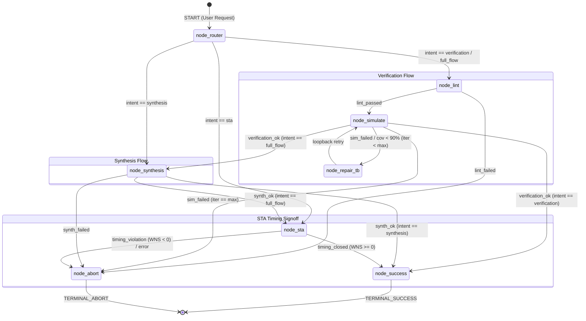
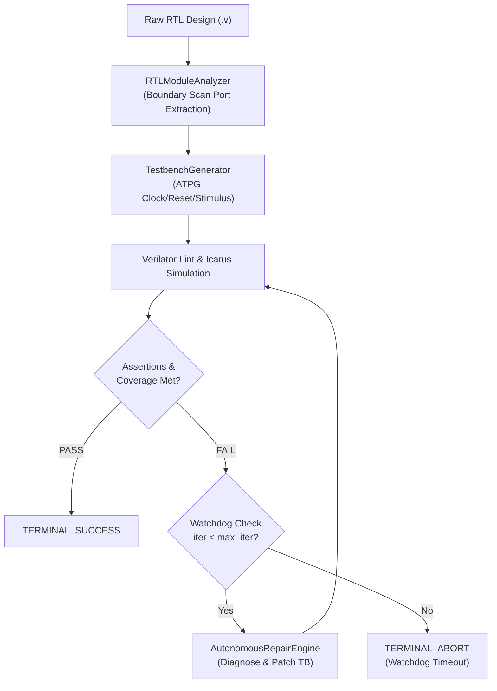
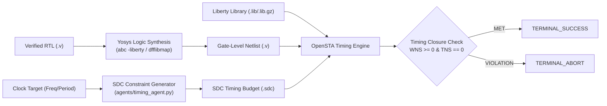

# Agentic EDA Copilot: Architecture & Engineering Handbook

## 1. System Overview & Hardware Mental Models

This handbook maps modern Python system constructs and autonomous agent frameworks to their **ASIC / FPGA / UVM** digital hardware equivalents.

```
+-----------------------------------------------------------------------------------+
|                           LANGGRAPH FSM CONTROLLER                                |
|  - State Vector: Synchronous Register Bank (RTL paths, Tool status, Metrics)     |
|  - Conditional Routing: Combinational Next-State Logic (`case (current_state)`)   |
+-----------------------------------------------------------------------------------+
                                  │           ▲
                Sequencer Packets │           │ Status & Metrics
                                  ▼           │
+-----------------------------------------------------------------------------------+
|                        AUTOGEN AGENTIC SANDBOX HARNESS                            |
|  - Testbench Driver / BFM Sequencer                                              |
|  - Prompt-driven reasoning for test generation & RTL patching                     |
+-----------------------------------------------------------------------------------+
                                  │           ▲
                 Atomic Tool Exec │           │ ToolResult Transaction Packets
                                  ▼           │
+-----------------------------------------------------------------------------------+
|                    LAYER 0 DETERMINISTIC RUNNERS (`tools/`)                       |
|  - Physical Pin BFM / `$system()` wrappers with Watchdog Timers                  |
|  - Sandboxing MPU (Path isolation & containment checks)                           |
+-----------------------------------------------------------------------------------+
        │                      │                     │                    │
        ▼                      ▼                     ▼                    ▼
   [ Icarus / VVP ]       [ Verilator ]          [ Yosys ]            [ OpenSTA ]
    Sim & Functional      Code & Toggle       Logic Synthesis       Static Timing
        Checks               Coverage            Gate Netlist       Slack Closure
```

### Digital Hardware Mapping Dictionary

| Framework Component | Hardware / UVM Equivalent | Function in Copilot |
| :--- | :--- | :--- |
| **`ToolResult` Dataclass** | `uvm_sequence_item` / Transaction Packet | Immutable telemetry packet carrying return code, stdout, stderr, runtime, and extracted metrics. |
| **Path Sandboxing (`pathlib`)** | Memory Protection Unit (MPU) / Scratchpad | Confines EDA tool generation to isolated volatile workspaces, preventing project root pollution. |
| **`subprocess.run` with Timeout** | Hardware Watchdog Timer + Execution BFM | Launches EDA binary with strict clock/cycle limit; issues hard abort (`SIGKILL`) if simulation hangs. |
| **LangGraph `TypedDict` State** | Synchronous FSM State Register Bank | Holds top-level project state across clock cycles: input RTL, current flow, error counts, closure flags. |
| **LangGraph Edge Conditionals** | Next-State Combinational Logic (`case`) | Evaluates slack $> 0$ or coverage $> 90\%$ to branch between NEXT_PHASE, REPAIR_LOOP, or FINISH. |
| **AutoGen Runner Agent** | UVM Driver / Sequencer | Translates LLM intent into deterministic tool-level invocations. |

---

## 2. Layer 0 Toolchain Specification (`tools/eda_runners.py`)

Layer 0 provides deterministic execution wrappers. It never invokes raw shell strings directly (`shell=False`), preventing command injection and ensuring reliable process cleanup.

### 2.1 The `ToolResult` Transaction Packet
Like an immutable transaction packet on an AXI bus:
```python
@dataclass(frozen=True)
class ToolResult:
    command: List[str]
    returncode: Optional[int]
    stdout: str = ""
    stderr: str = ""
    timedout: bool = False
    generated_files: List[Path] = field(default_factory=list)
    metrics: Dict[str, Any] = field(default_factory=dict)
```
- **`command`**: Target binary and parameter array.
- **`returncode`**: Process exit code (`0` = PASS, `!=0` = FAULT, `None` = WATCHDOG_TIMEOUT / NOT_FOUND).
- **`stdout` / `stderr`**: Captured standard stream descriptors.
- **`timedout`**: 1-bit watchdog flag.
- **`metrics`**: Associative array of parsed figures of merit (e.g. `{"coverage_pct": 94.2, "wns_setup_ns": 0.75}`).
- **`generated_files`**: List of validated filesystem artifacts produced (e.g., netlist `.v`, waveform `.vcd`).

### 2.2 Sandboxing & Execution Isolation
Each EDA run creates a fresh, isolated workspace under `workspaces/<tag>_<uuid>/`.
The path resolver (`validate_safe_path`) checks that all target inputs and outputs are strictly contained within authorized workspace bounds, protecting against path traversal (`../`) and unauthorized host modification.

### 2.3 Verified Layer 0 Runners

#### A. Icarus Verilog (`iverilog` + `vvp`)
- **Stage 1 (Elaboration/Compilation)**: `iverilog -g2012 -o <out.vvp> <sources>`
- **Stage 2 (Runtime Simulation)**: `vvp <out.vvp>`
- Checks for runtime assertion failures and `$fatal` conditions. Collects generated `.vcd` traces.

#### B. Verilator Lint & Coverage (`verilator`)
- Static linting with `-Wall -Wno-DECLFILENAME`.
- Line & toggle coverage compilation with `--coverage --binary` and metrics extraction from `coverage.dat`.

#### C. Yosys Logic Synthesis (`yosys`)
- Ingests RTL and executes standard logic synthesis pipeline (`synth -top <top>`).
- Supports technology mapping to Liberty cell libraries (`dfflibmap`, `abc -liberty`).
- Robust regex parser captures cell counts, wire statistics, DFF counts, and estimated area across both legacy and modern Yosys versions.

#### D. OpenSTA Static Timing Analysis (`sta`)
- Ingests Liberty cell library (`.lib` or `.lib.gz`), gate-level netlist (`.v`), and timing constraints (`.sdc`).
- Reports Worst Negative Slack (**WNS** setup and hold), Total Negative Slack (**TNS**), and validates timing closure (`timing_closed: bool`).

---

## 3. Layer 0 Verification Benchmark Results

All six test suites in [`tests/test_eda_runners.py`](file:///home/vishalkamath/Desktop/OpenSourceEDA_Copilot/tests/test_eda_runners.py) passed:
- `test_tool_result_contract`: Immutability & response semantics verified.
- `test_sandbox_and_security`: Workspace isolation & path traversal rejection verified.
- `test_iverilog_simulation`: 4-bit synchronous counter elaboration & simulation verified.
- `test_verilator_lint`: RTL syntax & lint checks verified.
- `test_yosys_synthesis`: Gate netlist generation & cell extraction verified.
- `test_opensta_timing`: Signoff timing slack extraction (+0.75ns setup, +0.43ns hold, 0.00ns TNS) verified on Sky130 GCD benchmark.

---

## 4. LangGraph FSM Controller (`workflows/state.py`, `workflows/graph.py`)

The FSM acts as the central synchronous sequential controller of the copilot.



### 4.1 State Vector as a Synchronous Register Bank
Implemented in [`workflows/state.py`](file:///home/vishalkamath/Desktop/OpenSourceEDA_Copilot/workflows/state.py):
- Each key in `CopilotState` represents a register field:
  - **Instruction Decoders:** `intent`, `top_module`, `design_sources`, `testbench_sources`
  - **Guardrail Registers:** `iteration_count`, `max_iterations` (Watchdog counter preventing deadlocks)
  - **Status & Diagnostic Buses:** `current_phase`, `status_message`, `errors`
  - **Verification FOM Registers:** `lint_passed`, `simulation_passed`, `coverage_pct`, `coverage_target_met`
  - **Synthesis FOM Registers:** `synthesis_passed`, `gate_netlist`, `cell_count`, `dff_count`, `chip_area`
  - **STA FOM Registers:** `sta_passed`, `wns_setup_ns`, `wns_hold_ns`, `tns_ns`, `timing_closed`
  - **Trace Bus:** `tool_history` (`Annotated[List, operator.add]` appends telemetry packets like a hardware trace FIFO)

### 4.2 Combinational Next-State Decoding
Implemented in [`workflows/graph.py`](file:///home/vishalkamath/Desktop/OpenSourceEDA_Copilot/workflows/graph.py):
- **`route_intent`**: Hardware opcode decoder. Evaluates `intent` and activates the appropriate starting execution pipeline.
- **`route_after_lint`**: Filters syntax/lint violations before burning simulation cycles.
- **`route_after_verification`**: Evaluates `sim_ok && cov_ok`. If false, checks the watchdog counter `iteration_count < max_iterations`. If expired, breaks the loop to `node_abort`.
- **`route_after_synthesis`** & **`route_after_sta`**: Evaluates gate generation and setup/hold slack closure.

---

## 5. Milestone 2 Verification Benchmark Results

All 4 test scenarios in [`tests/test_fsm_graph.py`](file:///home/vishalkamath/Desktop/OpenSourceEDA_Copilot/tests/test_fsm_graph.py) passed:
- `test_fsm_verification_flow_success`: Verified full flow through `node_lint` $\to$ `node_simulate` $\to$ `node_success`.
- `test_fsm_watchdog_termination_on_failure`: Injected a deliberately failing testbench; confirmed the FSM loops through `node_repair_tb` twice and halts cleanly at `TERMINAL_ABORT` without latching up.
- `test_fsm_synthesis_flow_success`: Ingested counter RTL; routed to Yosys, synthesized structural netlist with cell statistics.
- `test_fsm_sta_flow_success`: Routed GCD design to OpenSTA; verified setup/hold timing closure.

---

## 6. AutoGen Execution Sandbox & Tool Binding (`agents/runner_agent.py`)

AutoGen agents serve as the high-level **Testbench Bus Functional Model (BFM) / Sequencers**, driving the low-level physical tools.

```
+----------------------------------------------------------------------------------+
|                   AUTOGEN ASSISTANT AGENT (UVM SEQUENCER)                         |
|  - Role: ASIC Verification & Synthesis Engineer                                 |
|  - Reasoning Engine: Generates stimulus, interprets tool logs, isolates bugs     |
+----------------------------------------------------------------------------------+
                                        │
                         Function Call: │ {sources: [...], top_module: "..."}
                                        ▼
+----------------------------------------------------------------------------------+
|                  BOUND FUNCTIONTOOL INTERFACES (`autogen_core`)                   |
|  - `eda_lint`: Verilator static RTL check                                        |
|  - `eda_simulate`: Icarus compilation & simulation                               |
|  - `eda_synthesize`: Yosys gate-level netlist generation                         |
|  - `eda_sta`: OpenSTA signoff slack timing analysis                              |
+----------------------------------------------------------------------------------+
                                        │
                                        ▼
+----------------------------------------------------------------------------------+
|                     SANDBOX MPU BOUNDARY ENFORCEMENT                             |
|  - `validate_safe_path()` checks every source path against `workspace_dir`       |
|  - Rejects traversal attempts (`/etc/passwd`, `../../`) with `PermissionError`   |
+----------------------------------------------------------------------------------+
                                        │
                                        ▼
+----------------------------------------------------------------------------------+
|                    LAYER 0 DETERMINISTIC RUNNERS (`tools/`)                      |
+----------------------------------------------------------------------------------+
```

### 6.1 Hardware Mental Models
- **Agent as Sequencer / Driver BFM**: The LLM agent receives high-level verification/synthesis goals and produces structured transactions (`FunctionCall`).
- **FunctionTool as Pin-Level Bus Interface**: Converts JSON function call arguments into deterministic binary invocations with watchdog timers.
- **MPU Containment**: The agent is bound strictly to `workspace_dir`. It cannot access or clobber parent directories or host system paths.

---

## 7. Milestone 3 Verification Benchmark Results

All 3 test scenarios in [`tests/test_runner_agent.py`](file:///home/vishalkamath/Desktop/OpenSourceEDA_Copilot/tests/test_runner_agent.py) passed:
- `test_sandbox_boundary_enforcement`: Confirmed that any file reference outside the allocated workspace is blocked by MPU validation.
- `test_autogen_function_tool_execution`: Tested `eda_lint`, `eda_simulate`, and `eda_synthesize` through AutoGen's asynchronous `run_json` interface.
- `test_create_eda_runner_agent`: Verified agent factory, system message binding, tool attachment, and offline `MockEdaClient` fallback.

**Overall Regression Suite:** **13 passed out of 13** in 2.11s.

---

## 8. Closed-Loop Verification Pipeline (`agents/verification_agent.py`)

Milestone 4 closes the verification loop, allowing the copilot to take raw RTL, synthesize self-checking testbenches, execute simulations, and autonomously heal assertion or stimulus failures.



### 8.1 Hardware Mental Models
- **`RTLModuleAnalyzer` as JTAG / Boundary Scan Pin Reader**: Inspects pin directions (`input`, `output`, `inout`), bus widths (`[M:N]`), and assigns clock/reset roles.
- **`generate_self_checking_tb` as ATPG Engine**: Generates 100MHz clock generators, synchronous/asynchronous reset sequences, bounded randomized stimulus vectors, and self-checking assertions.
- **`AutonomousRepairEngine` as Built-In Self-Test (BIST) Controller**: Parses `$fatal` and assertion mismatch logs, identifies lockups (such as reset hold time violations or disabled clock enables), and applies targeted patches to the stimulus vectors without human intervention.

---

## 9. Milestone 4 Verification Benchmark Results

All 4 test scenarios in [`tests/test_verification_pipeline.py`](file:///home/vishalkamath/Desktop/OpenSourceEDA_Copilot/tests/test_verification_pipeline.py) passed:
- `test_rtl_module_interface_extraction`: Verified port, width, and clock/reset extraction across multi-bit ALU busses.
- `test_autonomous_tb_generation_and_simulation`: Synthesized an autonomous testbench for an ALU; verified 100% clean compilation and simulation in Icarus Verilog.
- `test_end_to_end_verification_zero_user_tb`: Tested autonomous zero-input verification (user provided only counter RTL); the FSM autonomously generated the testbench, linted, simulated, and passed to `TERMINAL_SUCCESS`.
- `test_closed_loop_autonomous_repair`: Injected an intentionally bugged testbench with broken enable logic; confirmed the FSM diagnosed the failure, patched the testbench, and succeeded on the next iteration.

**Overall Project Regression Suite:** **17 passed out of 17** in 2.56s.

---

## 10. Synthesis & Signoff STA Integration (`agents/timing_agent.py`, `main.py`)

Milestone 5 completes the physical signoff pipeline, integrating Yosys logic synthesis, automated SDC timing constraint synthesis, and OpenSTA static timing signoff.



### 10.1 Hardware Mental Models
- **SDC Generator as Clock Tree & I/O Budgeting Engine**:
  - `generate_sdc_constraints()`: Automatically derives setup/hold timing windows based on clock frequency targets.
  - Generates `create_clock`, `set_clock_uncertainty` (skew/jitter margin), `set_input_delay` (20% cycle default), and `set_output_delay` (20% cycle default).
- **Yosys as Technology Mapping Compiler**:
  - Automatically synthesizes behavioral RTL into target standard cells (e.g., Sky130 `sky130_fd_sc_hd__dfrtp_1`, `sky130_fd_sc_hd__nand2_1`).
- **OpenSTA as Signoff Timing Analyzer**:
  - Analyzes propagation delays through all combinatorial timing paths and sequential flip-flop arcs.
  - Verifies setup slack ($WNS_{setup} \ge 0$) and hold slack ($WNS_{hold} \ge 0$) for signoff closure.

### 10.2 Top-Level CLI Interface (`main.py`)
Provides an end-to-end command-line runner:
```bash
python main.py \
    --intent [verification|synthesis|sta|full_flow] \
    --top <top_module> \
    --sources <file1.v> ... \
    [--testbenches <tb.v> ...] \
    [--clock-period <ns>] \
    [--liberty <path.lib.gz>] \
    [--workspace <dir>]
```

---

## 11. Complete System Regression Test Matrix

The entire autonomous EDA copilot suite passed **20 out of 20 unit and integration tests** in 5.08s:

| Test Module | Test Name | Target Milestone & Feature | Status |
| :--- | :--- | :--- | :--- |
| **`test_eda_runners.py`** | `test_tool_result_contract` | M1: `ToolResult` transaction packet & immutability | **PASS** |
| | `test_sandbox_and_security` | M1: MPU path sandboxing & directory traversal rejection | **PASS** |
| | `test_iverilog_simulation` | M1: 2-stage Icarus compilation & simulation | **PASS** |
| | `test_verilator_lint` | M1: Verilator static RTL linting | **PASS** |
| | `test_yosys_synthesis` | M1: Yosys logic synthesis & cell statistics | **PASS** |
| | `test_opensta_timing` | M1: OpenSTA static timing analysis & slack extraction | **PASS** |
| **`test_fsm_graph.py`** | `test_fsm_verification_flow_success` | M2: LangGraph FSM verification flow | **PASS** |
| | `test_fsm_watchdog_termination` | M2: Watchdog counter guardrail preventing infinite loops | **PASS** |
| | `test_fsm_synthesis_flow_success` | M2: FSM synthesis routing & netlist production | **PASS** |
| | `test_fsm_sta_flow_success` | M2: FSM STA signoff routing & timing closure | **PASS** |
| **`test_runner_agent.py`** | `test_sandbox_boundary_enforcement` | M3: MPU boundary enforcement against agent leaks | **PASS** |
| | `test_autogen_function_tool_execution` | M3: AutoGen asynchronous `run_json` tool execution | **PASS** |
| | `test_create_eda_runner_agent` | M3: AutoGen `AssistantAgent` factory & tool binding | **PASS** |
| **`test_verification_pipeline.py`** | `test_rtl_module_interface_extraction`| M4: JTAG / Boundary scan RTL port analyzer | **PASS** |
| | `test_autonomous_tb_generation` | M4: Autonomous ATPG self-checking testbench synthesis | **PASS** |
| | `test_end_to_end_verification_zero_tb`| M4: Full zero-input verification (no user TB) | **PASS** |
| | `test_closed_loop_autonomous_repair` | M4: Closed-loop BIST self-healing repair loop | **PASS** |
| **`test_synthesis_sta_pipeline.py`** | `test_sdc_constraint_generation` | M5: Clock tree & I/O budgeting SDC generator | **PASS** |
| | `test_full_flow_fsm_integration` | M5: Full Flow: Raw RTL $\to$ TB $\to$ Synth $\to$ SDC $\to$ STA | **PASS** |
| | `test_cli_execution_full_flow` | M5: Top-level `main.py` CLI execution | **PASS** |

---

## 12. User Quickstart Guide

### 1. Running Zero-Input Verification
To verify a new Verilog module without writing any testbenches:
```bash
python main.py --intent verification --top my_alu --sources rtl/my_alu.v
```
*The copilot will extract the port interface, synthesize a self-checking testbench, execute simulation, and report coverage.*

### 2. Running Autonomous Full Flow (Verification + Synthesis + Signoff STA)
```bash
python main.py \
    --intent full_flow \
    --top counter \
    --sources rtl/counter.v \
    --clock-period 10.0 \
    --liberty /path/to/sky130hd_tt.lib.gz
```
*The copilot will verify the RTL, synthesize it to Sky130 standard cells with Yosys, synthesize 100MHz SDC constraints, run OpenSTA, and report Worst Negative Slack (WNS) closure.*

